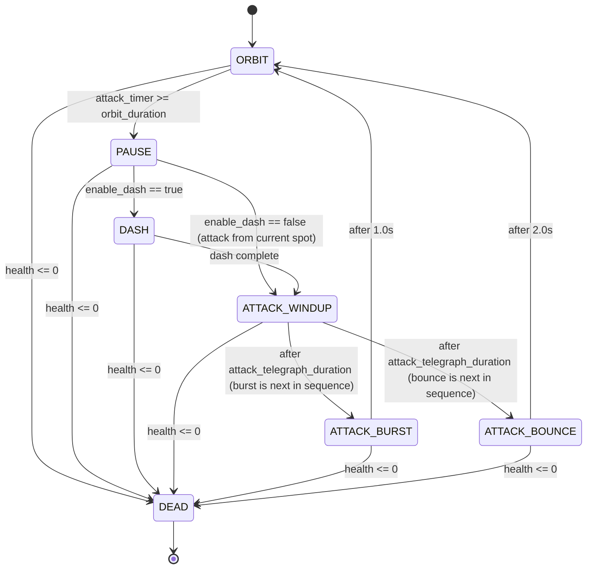

# Phantoon Boss Logic

Script: `Scripts/Enemies/phantoon.gd`
Scene: `Scenes/Enemies/phantoon.tscn`

Phantoon is an orbiting boss that alternates between circling an arena center point, dashing to a new position, and firing one of two attacks. It has two health-based phases and a periodic defensive intangibility window.

The eye is the weak zone: the `Hurtbox` is a deliberately small 5px circle, so the player has to aim at it. `ContactDamage` still covers the whole body.

## States (`BossState` enum)

| State | Purpose |
|---|---|
| `ORBIT` | Circles `arena_center` at `orbit_radius`/`orbit_speed`. Default/resting state. |
| `PAUSE` | Stops orbiting briefly before dashing (or before attacking, if dash is disabled). The dash target is shown by a marker. |
| `DASH` | Moves at constant `dash_speed` to the point on the orbit circle directly opposite the boss. |
| `ATTACK_WINDUP` | Holds still and glows for `attack_telegraph_duration`, then spawns the pending attack. |
| `ATTACK_BURST` | Radial burst attack is in-flight; boss holds position. |
| `ATTACK_BOUNCE` | Bouncing fireball attack is in-flight; boss holds position. |
| `DEAD` | Boss is fading out and about to `queue_free()`. |

Intangibility is **not a state**. It is an overlay flag (`is_intangible`) that only ever happens during `ORBIT`. See [Intangibility](#intangibility).

## State machine flow

Notes:
- Intangibility is an overlay on `ORBIT` and does not appear in the diagram. It never interrupts a dash or an attack.
- Death (`take_damage` → `HealthComponent` → `died` signal) can happen from any state and immediately forces `DEAD`, disabling all `CollisionShape2D`/`CollisionPolygon2D`/`Area2D` children.
- On spawn, `arena_center` is set so the boss's starting position is already on the orbit ring (orbit angle 0). The first orbit frame no longer teleports it.

## Transition timings (defaults)

| Transition | Duration/condition |
|---|---|
| `ORBIT` → `PAUSE` | `orbit_duration` (3.0s, phase 1) |
| `PAUSE` → `DASH` (or directly to attack if `enable_dash = false`) | `pause_duration` (1.0s, phase 1) |
| `DASH` → `ATTACK_WINDUP` | arrival at the target at `dash_speed` (200 px/s); `dash_duration` (0.5s) is a safety cap |
| `ATTACK_WINDUP` → attack state | `attack_telegraph_duration` (0.4s) |
| `ATTACK_BURST` → `ORBIT` | fixed 1.0s |
| `ATTACK_BOUNCE` → `ORBIT` | fixed 2.0s |

In Phase 2 (`enter_phase_2()`), `orbit_speed` is multiplied by 1.5, `pause_duration` by 0.75, `orbit_duration` by 0.8 and `intangible_interval` by 0.75. The boss orbits faster, pauses for less time, starts its attack cycle sooner and phases out more often. `intangible_duration` is unaffected by phase.

## Intangibility

A defensive behavior: the boss phases out and keeps orbiting, but never attacks while doing so.

- **Scheduling:** `intangible_timer` only counts tangible time. Once it reaches `intangible_interval` (15s) **and** the boss is in `ORBIT`, it starts. If the boss is mid-pause, dash or attack, it waits, so it never cuts an attack off.
- **Warning:** the sprite flickers for `intangible_warning_duration` (0.5s) before phasing out.
- **Attack hold:** while flickering or intangible, the `ORBIT` → `PAUSE` timer is frozen. The boss only orbits.
- **Phased out (`is_intangible`):** lasts `intangible_duration` (3s). `_set_phased(true)` (deferred) does the following:
  - `Hurtbox.monitorable` and `monitoring` are switched off. `monitorable` is the important one: projectiles find the hurtbox by overlapping it, so bullets and missiles pass straight through instead of being consumed. Missile explosion queries skip it too.
  - `ContactDamage.monitoring` and `monitorable` are switched off, so the player takes no contact damage and passes through.
  - `collision_layer` is set to 0.
  - The sprite alpha becomes `intangible_fade_amount` (0.5).
- **Exit:** `_set_phased(false)` restores everything, and `intangible_timer` resets to 0, so the next phase-out is a full interval away.
- `take_damage()` also returns early while intangible, as a backstop.

## Dash

- When the `ORBIT` → `PAUSE` transition happens, `dash_target` is set to `_opposite_orbit_point()`: `arena_center - (global_position - arena_center)`, the point on the ring directly across from the boss.
- The dash is always the same length (2 × `orbit_radius`, 80px by default), so it takes about 0.4s at `dash_speed` 200 and always passes through the arena center.
- **Dash marker:** from the start of the pause until the boss arrives, `_draw()` shows a ring at the target and a faint line along the path. It's redrawn every frame while visible. Turn it off with the `show_dash_marker` export (default on).
- The orbit direction reverses at the moment the dash starts.

## Attack sequence (`_next_attack()`)

Attacks are a fixed sequence, not random. Every time the boss reaches the end of a dash (or skips the dash, if disabled), `perform_attack_selection()` takes the next attack and goes to `ATTACK_WINDUP`:

- **Phase 1:** burst, burst, bounce, repeat (`PHASE_1_ATTACK_SEQUENCE`).
- **Phase 2:** burst, bounce, repeat (`PHASE_2_ATTACK_SEQUENCE`). `attack_index` resets to 0 when phase 2 starts.
- If only one attack toggle is enabled, that attack is always used.
- If both `enable_burst_attack` and `enable_bounce_attack` are `false`, no attack is spawned and the boss returns straight to `ORBIT`.

### Windup telegraph

In `ATTACK_WINDUP` the boss holds still for `attack_telegraph_duration` (0.4s) while the sprite glows more and more in the same warm yellow (`WINDUP_COLOR`) for both attacks. The attack spawns when the windup ends. The damage flash and the phase-2 flash still draw over it.

## Attacks

### Radial Burst (`spawn_burst_attack`)
- **Phase 1:** `burst_projectile_count` (6) `RadialProjectile` instances in an evenly spaced ring, offset by `phase_1_burst_rotation` (0, so the first one points right).
- **Phase 2:** `phase_2_burst_count` (8) projectiles, one every 45°. `phase_2_burst_rotation` is -90° (`-PI / 2`), so the first projectile points straight up (0°) and the rest follow every 45° around the ring.
- The angle step is `TAU / count`, so the ring stays even if you change the count.
- **Held ring, launched together:** after the yellow windup glow, the whole ring spawns at once, held in place and already pointing outward, so the player can see where each projectile will come from. After `burst_hold_duration` (0.5s) **every projectile launches at the same moment**, with no order. `launch(dir, speed, source, delay)` carries the delay (the same for all), and `launch_delay` counts down in the projectile's `_physics_process`, which skips movement and the lifetime timer until it reaches 0.
- **Live while held:** a hovering projectile is fully active. It can hurt the player and be shot down for a drop. Only its flight is delayed.
- `ATTACK_BURST` normally lasts 1.0s. If the hold is longer than 0.7s (`burst_hold_duration + 0.3`), the state lasts that long instead, so the boss stays still until the ring has launched.
- Each projectile spawns at `global_position + direction * burst_spawn_offset` (24px outside the boss's own body by default) so it doesn't visually spawn inside the boss sprite.
- Speed is `phase_1_burst_speed` (100) or `phase_2_burst_speed` (150) depending on phase.
- Projectiles fly in a straight line and self-destruct (fade) on hitting a wall, the player, or after their lifetime expires.
- The player can shoot them down. A projectile shot down this way has a chance to drop a pickup (see [Projectile drops](#projectile-drops)).

### Bouncing Fireballs (`spawn_bounce_attack`)
- Spawns `phase_1_bounce_count` (6) or `phase_2_bounce_count` (8) `BouncingFireball` instances in a horizontal line `bounce_spawn_height` (40px) **above** the boss, evenly spaced `bounce_spacing` (20px) apart and centered over the boss. The curtain falls from above, which gives the player a longer fall time to react.
- **Walls and ceilings:** a non-floor collision destroys a fireball on its first move, so each spawn point is checked with a ray from the boss to that point (World layer). If something is in the way, the point is pulled back `FIREBALL_WALL_MARGIN` (8px) from it. If that leaves it closer than `FIREBALL_MIN_SPAWN_DISTANCE` (14px) to the boss, that fireball is skipped. Near a low ceiling the curtain bends under it, and some fireballs may be missing.
- **No self-collision:** fireballs pass through the boss that fired them. Their bodies only collide with the world, and their hitbox ignores the boss's hurtbox (`shooter`). The boss's `ContactDamage` area is a `Hitbox` that calls `receive_hit` on any hurtbox it overlaps, so `_shot_down()` also ignores any hit whose `source` is the shooter. Without that, fireballs falling through the boss's body (the middle ones, under the curtain) faded when they touched its contact area. Burst projectiles have the same exception.
- **Curtain sweep:** all fireballs spawn at once, but each hovers in place for `sweep_order * bounce_release_delay` (0.12s per fireball) before it starts to fall. The row drops from one end to the other like a wave. `setup(gravity, speed, source, delay)` carries the delay, and `release_delay` counts down in the fireball's `_physics_process`, which skips gravity and movement until it reaches 0.
- **Alternating direction:** `bounce_sweep_direction` flips after every cast. One cast sweeps left to right, the next right to left, so the player can't just wait on one side. The first cast of a fight is left to right.
- **Live while held:** a hovering fireball is fully active. It can hurt the player and can be shot down for a drop. Only its fall is delayed.
- The sweep fits inside the 2s `ATTACK_BOUNCE` state: the last fireball of 6 starts falling after about 0.6s.
- Each fireball falls under `bounce_gravity` and bounces off floors up to `MAX_BOUNCES` (5) times, losing speed each bounce, before self-destructing. Sideways drift is random up to `bounce_horizontal_drift` (50 px/s) and applied when the fireball is released. Set it to 0 for fireballs that fall straight down in clean columns.
- Fireballs can also be shot down for a drop.

### Projectile drops

Both `RadialProjectile` and `BouncingFireball` have a `drop_table` export and a `_shot_down()` method, called when the player's shot hits their `Hurtbox`.

- On the first hit only (`is_fading` guard), `_shot_down(source)` fades the projectile. It calls `DropManager.try_drop(self, drop_table)` **only if `source` is in the `player` group**. The `source` is whoever fired the shot: bullets, charge beams and missile explosions all pass the player.
- A hit from anything else still fades the projectile but never drops. This covers any non-player damage.

### Projectiles ignore each other

`BouncingFireball` and `RadialProjectile` each have a `Hitbox` and a `Hurtbox` on the shared hitbox and hurtbox layers. Without a filter, one projectile's hitbox counts a neighbouring projectile's hurtbox as an enemy, and makes it fade. Fireballs spawn only 20px apart with 12px-wide hitboxes, so they touched easily while falling and faded before reaching the floor.

- Both scripts now skip any overlapping area whose parent is a `BouncingFireball` or a `RadialProjectile`. A burst crossing the fireballs no longer cancels either.
- Fireballs also store `shooter` (passed as the third argument of `setup(gravity, speed, source)`) and skip the boss that fired them, so a fireball can't damage its own boss.
- Player shots hit a projectile's `Hurtbox` through the player's own hitbox, so shooting projectiles down is unaffected.
- Projectiles that fade on their own never drop anything: a wall hit, a player hit, max bounces or the lifetime running out.
- If `drop_table` is empty, `_ready` creates a default `DropTable` with `drop_chance = DEFAULT_DROP_CHANCE` (0.2). That's lower than the enemy default (0.7) since up to 6 projectiles spawn at once.
- Health vs missile weights are the `DropTable` defaults. Missile refills only drop once the player has missiles unlocked, as for other enemies.

## Phases

- **Phase 1:** default values, attack sequence burst, burst, bounce.
- **Phase 2:** triggered once when `health.current_health <= max_health / 2`. Increases orbit speed and attack frequency, and switches to the burst, bounce sequence. Triggers a brief white flash on the sprite as a visual cue. Phase 2 only triggers once (`phase_2_triggered` guard), and never on the hit that kills the boss.

## Visuals

`_update_visuals(delta)` computes the sprite `modulate` once per frame, so effects can't overwrite each other:

1. White by default, or the phase-2 flash (`PHASE_FLASH_COLOR`, 0.2s), or the red damage tint while `damage_flash_timer` is running (0.12s).
2. Alpha is `intangible_fade_amount` while intangible, or flickers during the warning.
3. If dying, alpha fades from 1 to 0 over `death_duration`.

## Damage & Death

- `take_damage()` is ignored while intangible or `DEAD`.
- Taking damage tints the sprite red briefly (`damage_flash_timer`, 0.12s) and checks for the Phase 2 transition.
- **Death drops are guaranteed.** On death, `DropManager.drop_guaranteed()` spawns `death_health_drops` (10) health pickups and `death_missile_drops` (10) missile refills. There is no roll and no missile-unlock check.
  - They scatter horizontally within `death_drop_spread` (48px) of the boss, with a small random vertical offset.
  - They stay for `death_drop_lifetime` (20s) instead of the default 8s, since there are 20 of them to collect.
  - The old `drop_table` export no longer exists on the boss.
  - Missile refills are ignored by the player while missiles are locked. They are still spawned, and despawn on their timer.
- On death (`HealthComponent.died` signal), the boss clears intangibility and disables all its `CollisionShape2D`/`CollisionPolygon2D` children. `Area2D` children stop monitoring and become non-monitorable, so projectiles stop being consumed. It then fades its sprite out over `death_duration` (0.5s) and `queue_free()`s.

## Feature toggles (for testing)

All default to `true`, meant to be disabled individually for isolated testing:

- `enable_dash` — if `false`, the boss skips the dash and attacks immediately from its current orbit position after the pause.
- `enable_burst_attack` — if `false`, only bounce attacks are ever chosen.
- `enable_bounce_attack` — if `false`, only burst attacks are ever chosen.
- `enable_intangibility` — if `false`, the boss never becomes intangible.

## Other exports

| Export | Default |
|---|---|
| `bounce_release_delay` | 0.12 |
| `burst_hold_duration` | 0.5 |
| `phase_1_bounce_count` / `phase_2_bounce_count` | 6 / 8 |
| `bounce_spawn_height` / `bounce_spacing` | 40 / 20 |
| `bounce_horizontal_drift` | 50 (replaces the old `bounce_projectile_speed`, which only controlled this) |
| `phase_2_burst_count` | 8 |
| `phase_2_burst_rotation` | -PI/2 (straight up) |
| `death_health_drops` / `death_missile_drops` | 10 / 10 |
| `death_drop_spread` / `death_drop_lifetime` | 48 / 20 |
| `attack_telegraph_duration` | 0.4 |
| `show_dash_marker` | true |

## Intangibility exports

| Export | Default |
|---|---|
| `intangible_interval` | 15.0 |
| `intangible_duration` | 3.0 |
| `intangible_warning_duration` | 0.5 |
| `intangible_fade_amount` | 0.5 |
